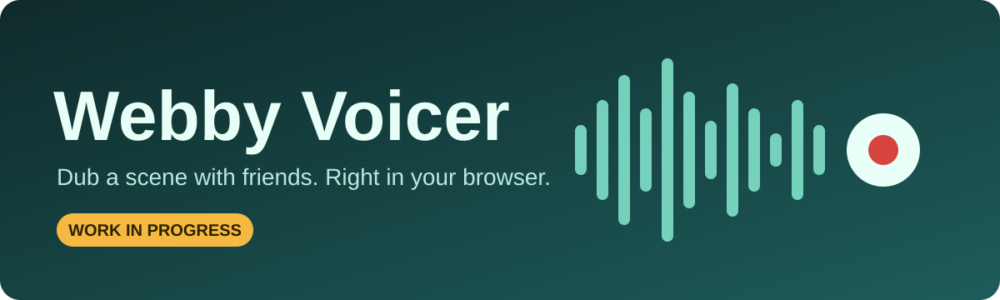
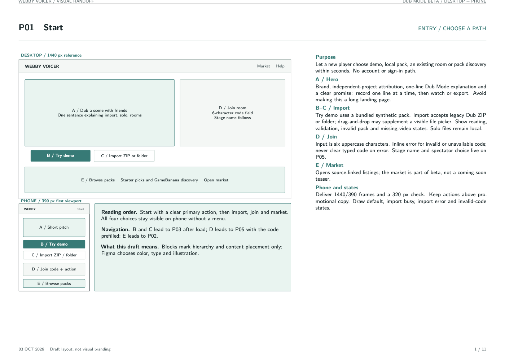

<p align="center">
  
</p>

<p align="center">
  
  
  
</p>

<p align="center">
  
  
  
  
</p>

> [!WARNING]
> **This project is under active development and is not released.** Expect rough edges, missing features and breaking changes. Nothing is deployed, and no public service exists yet.

**Webby Voicer** is a free, browser-based dubbing game. Load a scene, record your own voice one line at a time, then watch the result or export it. You can do it solo or with friends in an anonymous room, with no account and no install.

It reads existing *Dub* packs from [The Choicer Voicer](https://yeahmaybe.itch.io/the-choicer-voicer). It is an independent project and is **not affiliated with or endorsed by its creator**.

## Roadmap

| Area | Status | Notes |
| --- | :---: | --- |
| 🎬 Dub Mode: import, record, retake, play, export | 🟢 Working locally | Tested on one real pack and a synthetic demo pack, on desktop only |
| 🏠 Anonymous rooms (6-character codes, up to 8 performers, spectators) | 🟢 Working locally | Roles, turn order, lock, reactions, optional voting, scheduled showcase |
| 🛒 Pack market (curated shelf and GameBanana listings) | 🟡 Early | Every listing links to its source page; no creator files are mirrored |
| 📱 Phone and cross-browser testing | 🔴 Not done | iOS Safari, Android, microphone and download behaviour still unverified |
| 🛡️ Rate limits and cost monitoring | 🔴 Not done | Required before any public beta |
| ☁️ Deployment | 🔴 Not done | Cloudflare resources have not been created |
| 🎭 Classic Mode (impression game with scoring) | ⚪ Planned | After Dub Mode ships |
| ✍️ Creator pack submissions | ⚪ Planned | Maybe, after Classic Mode |

## What works today

- **Import** a legacy Dub ZIP or folder: `dub_video.ogv`, per-line audio and timestamps, characters, and an optional `_backing_track`.
- **Record and retake** one line at a time, with a waveform, and hear your take mixed into the scene.
- **Play** the finished scene with subtitles and creator credit, and **export** the video locally in your browser.
- **Rooms:** the host assigns roles, controls turn order, shares the pack, and starts a scheduled group showcase. Shared media is deleted when the room ends, and abandoned rooms expire after three hours.
- **Legacy video path:** if your browser can't play Ogg Theora, the app converts the video locally with ffmpeg.wasm (about 31 MiB, downloaded once and cached).
- **Try demo:** a built-in synthetic pack with a public-domain video, so you can try it without any files.

## Design preview

The UI is still at wireframe stage. These are the first of eleven pages in the handoff, shown with draft layout and no visual branding.

<p align="center">
  
</p>

- [Visual wireframes (PDF, 11 pages)](output/pdf/webby-voicer-visual-wireframes.pdf), with [editable TikZ source](docs/design/FIGMA_RIVE_WIREFRAMES.tex)
- [Figma and Rive handoff specification (PDF)](output/pdf/webby-voicer-figma-rive-handoff.pdf)

## Getting started

You need Node.js 20 or newer.

```sh
npm install
npm run build
npm run dev:worker
```

Open <http://127.0.0.1:8787>. The Worker serves the app, rooms and the pack market, using local Durable Object and R2 storage.

For live UI updates, keep the Worker running, start `npm run dev` in a second terminal, and open the Vite URL it prints. `/api` requests are forwarded to the Worker.

### Checks

```sh
npm test                  # unit tests
npm run build             # typecheck and bundle
npm run typecheck:worker  # typecheck the Worker
npm run test:room         # smoke test; needs the Worker running
```

To repeat the real-pack compatibility test, set `WEBBY_REAL_PACK` to the path of a Dub ZIP when running `npm test`. No real packs are included in this repository.

## Architecture

```
src/       React + TypeScript app (pack import, recording, scene playback and export, room UI, market)
server/    Cloudflare Worker: static assets, room API, market proxy
           └─ one Durable Object per room; R2 holds temporary room media
tests/     Vitest: import, metadata, timeline, real-pack compatibility
scripts/   demo pack builder, ffmpeg core staging, room smoke test
docs/      design handoff and implementation plans
```

Pack parsing and timeline logic live in small, testable modules. Media processing happens in the browser wherever it can.

## Known limits

- Compatibility is proven on **one** unmodified real pack. More packs and more devices are needed before claiming broad support.
- Mobile browsers, microphone permissions and file downloads are untested. Some browsers may need a tap to start the showcase.
- GameBanana listings open the original page to download. One-click loading will only be added for packs whose creators or licenses allow redistribution.
- Not deployed. Rate limits and cost monitoring come first. The target is a hosting budget of roughly USD 5–20 per month.

## Deployment (planned)

The plan is Cloudflare Workers Static Assets, one Durable Object per room, and R2 for temporary room media. Deploying means creating the `webby-voicer-room-media` bucket in the right Cloudflare account and reviewing the domain first. This has not been done.

## Project docs

- [Current product plan](WEBBY_VOICER_PLAN.md): confirmed scope and delivery sequence
- [Initial proposal](CHOICER_VOICER_PLAN.md): superseded where the plan above differs
- [Dub rehearsal implementation plan](docs/superpowers/plans/2026-10-02-dub-rehearsal.md)

## Credits and sources

- [Official Dub pack guide](https://thechoicervoicer.neocities.org/v2/content_guide/dub_packs) and the [GameBanana hub](https://gamebanana.com/games/20674) / [public API](https://api.gamebanana.com/)
- Test video `320x240-2.ogv` by Xiph.org, public domain ([source](fixtures/SOURCE.md))
- Built on [React](https://react.dev), [Vite](https://vite.dev), [ffmpeg.wasm](https://ffmpegwasm.netlify.app) and [Cloudflare Workers](https://developers.cloudflare.com/workers/)

## License

No license has been chosen yet, so all rights are reserved for now. A license will be added before any public release.
